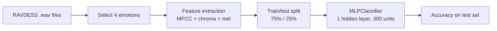

# VoxMood

Speech emotion classification from audio features, using an MLP trained on the RAVDESS dataset.

 

## Problem

Speech carries emotional information in tone and pitch. Speech emotion recognition (SER) tries to infer a speaker's emotional state from audio. It is hard because emotions are subjective and audio is difficult to annotate.

## Dataset

[RAVDESS](https://zenodo.org/record/1188976) (Ryerson Audio-Visual Database of Emotional Speech and Song). The audio is **not included** in this repository. Download it separately and place the `Actor_*` folders in `data/ravdess/`.

Emotion labels come from the third field of each RAVDESS file name. The notebook keeps four of the eight emotions: `calm`, `happy`, `fearful` and `disgust`.

## Method



- **Features:** per file, the mean over time of 40 MFCCs, the chroma STFT and the mel spectrogram, concatenated into one vector (`librosa`).
- **Model:** `sklearn.neural_network.MLPClassifier(hidden_layer_sizes=(300,), alpha=0.01, batch_size=256, learning_rate='adaptive', max_iter=500)`.
- **Split:** `train_test_split(test_size=0.25, random_state=9)`.

## Results

The saved notebook contains no outputs, so this repository reports **no accuracy figure**. Run the notebook on your copy of RAVDESS to produce one.

## How to run

```bash
git clone https://github.com/Praneetha1844/CodeAlpha_SpeechEmotionRecognition.git
cd CodeAlpha_SpeechEmotionRecognition
python -m venv .venv && source .venv/bin/activate   # Windows: .venv\Scripts\activate
pip install -r requirements.txt jupyter
# put RAVDESS Actor_* folders in data/ravdess/
jupyter notebook notebooks/ravdess_mlp_emotion_classifier.ipynb
```

The notebook reads audio from `../data/ravdess`, relative to the `notebooks/` folder.

## Repository structure

```
.
├── notebooks/ravdess_mlp_emotion_classifier.ipynb   # feature extraction, training, evaluation
├── data/                                            # place RAVDESS here (not tracked)
├── requirements.txt
├── .github/workflows/ci.yml                         # validates notebooks, resolves dependencies
└── LICENSE
```

## Limitations and notes

- No result is stored, and no evaluation beyond a single train/test accuracy is implemented.
- Only 4 of the 8 RAVDESS emotions are used.
- RAVDESS is acted speech from 24 speakers. Performance on spontaneous speech or other languages and accents is untested.
- The split is random per file, not per speaker, so the same speaker can appear in both train and test sets. This can inflate accuracy.
- Emotion recognition from voice is error-prone and can encode bias. Do not use it for decisions about people.

## Future work

- Split by speaker and report per-class precision, recall and a confusion matrix.
- Try other classifiers and a small CNN over spectrograms.
- Add cross-validation and a fixed, documented environment.

## Credits

The feature-extraction and model setup follow the DataFlair speech emotion recognition tutorial. Dataset: Livingstone and Russo, RAVDESS.

## License

MIT. See [LICENSE](LICENSE).
